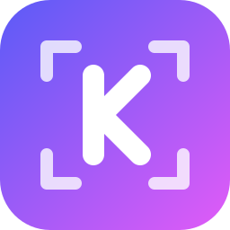
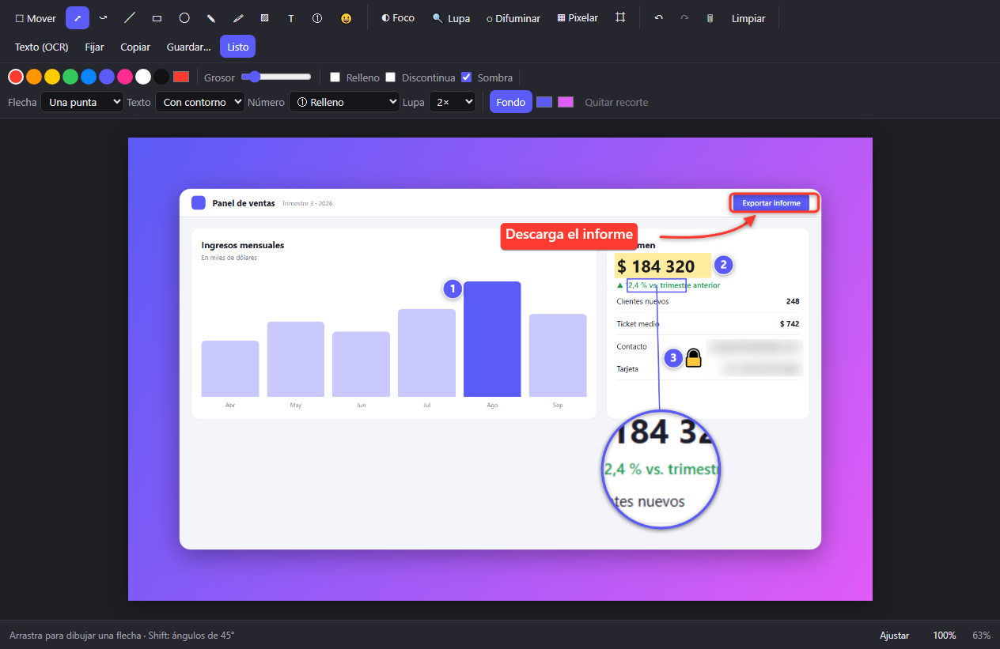
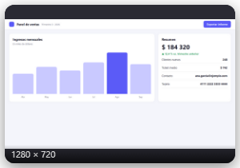
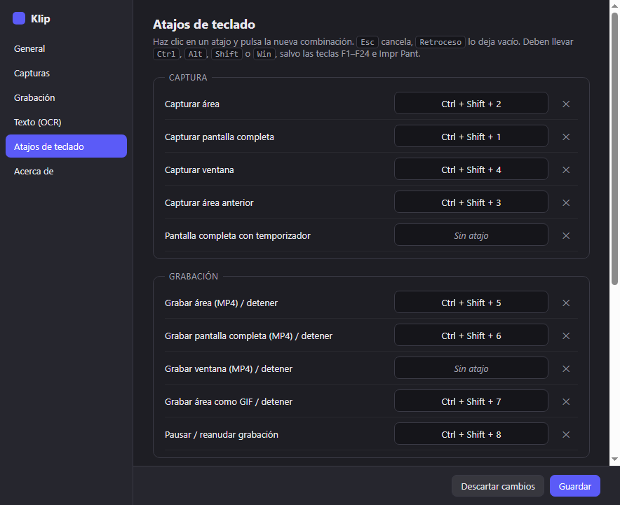
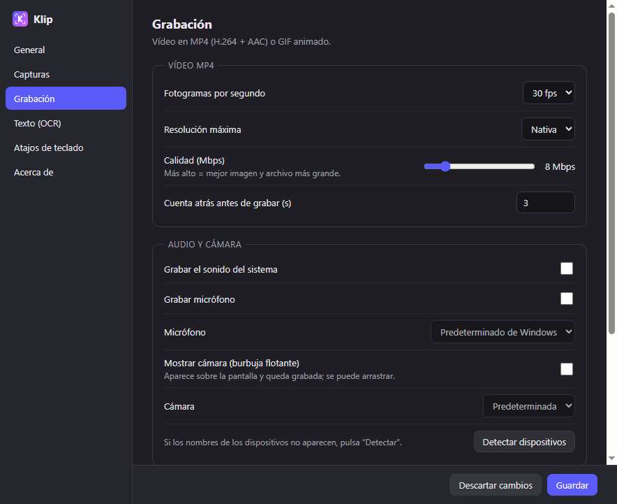
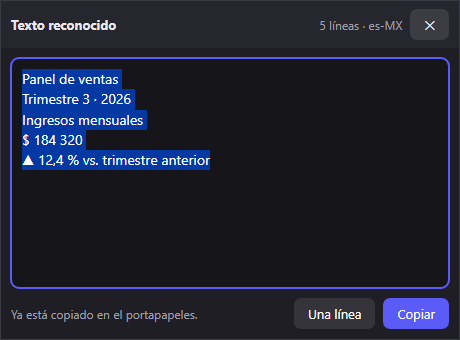

<p align="center"></p>

<h1 align="center">Klip</h1>

<p align="center"><b>Herramienta gratuita y de código abierto para capturas y grabaciones de pantalla en Windows.</b></p>

<p align="center">
  <a href="https://github.com/LudwigAngel/klip/releases/latest"></a>
  <a href="https://github.com/LudwigAngel/klip/actions/workflows/ci.yml"></a>
  <a href="LICENSE"></a>
</p>

Klip nace como un aporte a la comunidad: una alternativa libre para Windows inspirada en el flujo de trabajo de
[CleanShot X](https://cleanshot.com), la conocida app de macOS. Es para quien quiera usarla, estudiarla, mejorarla o
compartirla. ¡Las contribuciones son bienvenidas!

> Klip es un proyecto independiente. **No está afiliado ni respaldado por CleanShot X ni por MTW**, y no contiene
> código, diseños ni recursos suyos: todo se escribió desde cero tomando solo la *idea* de las funciones.
> CleanShot X es marca de sus respectivos dueños.



## Capturas de pantalla

| Miniatura tras capturar | Barra de grabación |
|---|---|
|  |  |

| Atajos de teclado configurables | Opciones de grabación |
|---|---|
|  |  |

| Texto reconocido (OCR) |
|---|
|  |

Las imágenes se generan con datos de ejemplo: `set KLIP_SCREENSHOTS=docs\screenshots&& npx electron .`

## Funciones

**Capturas**
- Área (con lupa, coordenadas y tamaño en vivo), pantalla completa, ventana (resaltada al pasar el ratón) y área anterior.
- Captura de ventana sin lo que la tapa, con sombra opcional y fondo transparente.
- Temporizador, varios monitores, PNG o JPG, copia automática al portapapeles.
- Miniatura flotante tras cada captura: copiar, guardar, editar, fijar, OCR, arrastrar el archivo a otras apps.

**Editor de imágenes**
- Flechas (rectas, curvas, doble punta), líneas, rectángulos, elipses, lápiz y resaltador.
- Texto (contorno, etiqueta o simple), números de pasos (relleno, contorno o letras), emojis y sellos.
- Foco (oscurece todo menos lo importante), lupa ampliada, difuminar y pixelar para ocultar datos.
- Todo se puede seleccionar, mover, redimensionar y cambiar de estilo después. Deshacer/rehacer, recorte, zoom.
- Fondo decorativo con degradado, sombra y esquinas redondeadas.

**Grabación**
- MP4 (H.264 + AAC) de área, ventana o pantalla completa; GIF animado.
- Sonido del sistema, micrófono y burbuja de cámara; cuenta atrás, pausa y control flotante (que no sale en el vídeo).

**Más**
- **OCR**: extrae el texto de cualquier zona de la pantalla con el motor integrado de Windows (sin internet).
- Fijar capturas encima de todo (zoom con la rueda, opacidad con Ctrl+rueda).
- **Atajos de teclado configurables** para cada acción, con detección de conflictos.
- Configuración completa: carpetas, formato, calidad, fps, dispositivos, idioma de OCR, inicio con Windows.

## Atajos predeterminados

| Acción | Atajo |
|---|---|
| Capturar área | `Ctrl+Shift+2` |
| Capturar pantalla completa | `Ctrl+Shift+1` |
| Capturar ventana | `Ctrl+Shift+4` |
| Capturar área anterior | `Ctrl+Shift+3` |
| Grabar área MP4 (repetir para detener) | `Ctrl+Shift+5` |
| Grabar pantalla completa MP4 | `Ctrl+Shift+6` |
| Grabar área como GIF | `Ctrl+Shift+7` |
| Pausar / reanudar grabación | `Ctrl+Shift+8` |
| Extraer texto (OCR) | `Ctrl+Shift+O` |
| Abrir última captura en el editor | `Ctrl+Shift+E` |

Se cambian en **Configuración → Atajos de teclado** (clic derecho en el icono de la bandeja).

## Instalación

1. Descarga `Klip-Setup-0.3.1.exe` desde [Releases](https://github.com/LudwigAngel/klip/releases).
2. Ejecútalo. No necesita permisos de administrador.
3. Como el instalador no está firmado digitalmente, Windows SmartScreen puede avisar: pulsa
   **Más información → Ejecutar de todos modos**.

Requisitos: Windows 10/11 de 64 bits. El OCR usa los idiomas instalados en Windows
(Configuración → Hora e idioma → Idioma).

## Desarrollo

Requiere [Node.js](https://nodejs.org) 22.12 o superior.

```bash
git clone https://github.com/LudwigAngel/klip.git
cd klip
npm install          # si npm bloquea el script de Electron: npm approve-scripts electron && npm rebuild electron
npm start            # arranca Klip en modo desarrollo
npm run check        # revisión de sintaxis de todos los archivos
npm run smoke        # prueba automática: captura, OCR, ventanas, MP4, GIF, editor
npm run dist         # genera el instalador en dist/
```

### Estructura

```
src/
  main.js        proceso principal: bandeja, atajos, capturas, grabación, ventanas
  settings.js    configuración persistente (%APPDATA%\Klip\settings.json)
  ocr.js/.ps1    OCR con Windows.Media.Ocr
  windows.js/.ps1  listado de ventanas y composición de sombra
  preload.js     puente IPC seguro (contextIsolation + sandbox)
  renderer/      páginas: selección, editor, miniatura, fijar, grabador, barra, configuración, OCR
scripts/         revisión de sintaxis y generación del icono
```

Tecnología: Electron, JavaScript sin frameworks, [gifenc](https://github.com/mattdesl/gifenc) para GIF.

## Contribuir

Lee la [guía de contribución](CONTRIBUTING.md). En resumen:

- [Reporta un error o propone una idea](https://github.com/LudwigAngel/klip/issues/new/choose) con las plantillas.
- Haz *fork*, crea una rama desde `main` y envía un *pull request*. Ejecuta `npm run check` y `npm run smoke`
  antes; GitHub Actions repite las pruebas en Windows en cada pull request.
- Ideas pendientes: captura con scroll, dibujar en vivo durante la grabación, mostrar clics y teclas,
  editor de vídeo (recortar), historial de capturas.

## Licencia

[MIT](LICENSE) — libre para usar, copiar, modificar y distribuir, también con fines comerciales,
manteniendo el aviso de copyright.

---

## English

**Klip** is a free, open-source screenshot and screen-recording tool for Windows, inspired by the workflow of
CleanShot X for macOS. It is an independent project, not affiliated with CleanShot X or MTW, and contains none of
their code or assets. Features: area/window/fullscreen capture, annotation editor (arrows, curved arrows, text, step
numbers, spotlight, magnifier, blur, pixelate, emojis), pin to screen, MP4/GIF recording with system audio,
microphone and webcam, offline OCR, and fully configurable global hotkeys. Licensed under MIT. Contributions welcome.
